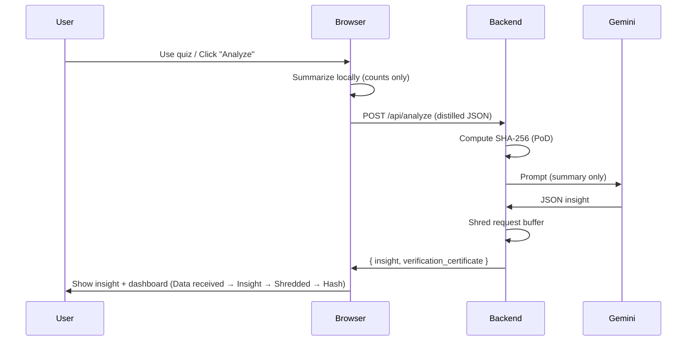

# NeuroNet MVP — Privacy-by-Design Behavioral Insight

**Why this exists:** This isn’t just a telemetry tracker. It’s a prototype for **Zero-Data business intelligence** that stays **DPDPA-compliant** by design: we process minimal data, return an insight, then **purge** what we received and give you a **Proof-of-Deletion** so you can verify that your data was hashed and not retained in raw form.

---

## DPDPA Compliance Angle

- **Data minimization:** Only distilled counts (tab switches, keystrokes, session duration) are sent. Raw mouse coordinates and event logs stay on the client.
- **Purpose limitation:** Data is used only to classify behavioral state (Focused / Confused / Distracted) and is not used for profiling or ads.
- **Storage limitation & purge:** The server overwrites the incoming payload in memory (shredder) after generating the insight and does not store raw telemetry.
- **Verifiability:** A SHA-256 hash of the request payload is computed *before* deletion and returned as a **Verification Certificate** (Proof-of-Deletion), so users can trust that their data was processed and then purged.

---

## Trigger → Process → Purge Flow



---

## Adding your own LLM

The AI layer is **open and pluggable**. You can use the default (Gemini) or add any LLM:

- **Env-based:** Set `LLM_PROVIDER` in `.env` to `gemini`, `openai`, or `ollama`. See `env.example` for the extra keys each provider needs.
- **Code:** Edit `llm_providers.py`: add a function `def _myllm_generate(prompt: str) -> str` and register it in the `PROVIDERS` dict. The app will use it if you set `LLM_PROVIDER=myllm` (or wire your name in the code).

No lock-in: the backend only calls `generate_insight(prompt)`; the implementation is up to you.

---

## Quick Start

1. **Environment**
   - Copy `env.example` to `.env`. For default (Gemini) set `GOOGLE_API_KEY`. For another LLM set `LLM_PROVIDER` and the matching keys (e.g. `OPENAI_API_KEY` for `openai`).
2. **Backend**
   - `python -m venv venv && source venv/bin/activate` (or `venv\Scripts\activate` on Windows)
   - `pip install -r requirements.txt`
   - `uvicorn main:app --reload --host 127.0.0.1 --port 8000`
3. **Frontend**
   - Open `demo.html` in a browser (or serve the folder with any static server).

**One-command run & test:** `./run_and_test.sh` starts the backend and a static server, runs a quick API check, then prints the frontend URL. Use `LLM_PROVIDER=mock` for testing without an API key (e.g. `LLM_PROVIDER=mock ./run_and_test.sh`).

---

## Repo Layout

| Item | Role |
|------|------|
| `main.py` | FastAPI app: `/api/analyze`, shredder, PoD hash; calls pluggable LLM |
| `llm_providers.py` | Pluggable LLM: Gemini (default), OpenAI, Ollama; add your own via `PROVIDERS` |
| `telemetry.js` | Client-side event capture (stored locally only) |
| `localanalysis.js` | Client-side summarization; sends only counts to backend |
| `dashboard.js` | Transparency dashboard + Privacy Mode modal |
| `demo.html` / `style.css` | Quiz UI, Analyze button, spinner, dashboard, privacy modal |

---

## Legal Disclaimer

This project is a **Privacy-by-Design experiment** for educational and prototyping purposes. It is not legal advice. Compliance with DPDPA or other privacy laws depends on your deployment, policies, and jurisdiction—consult legal counsel before using in production.

---

## Publish to GitHub

From the project root (NeuroNet_MVP):

```bash
git remote add origin https://github.com/YOUR_USERNAME/NeuroNet_MVP.git
git branch -M main
git push -u origin main
```

If the repo already exists on GitHub with a different name, use that repo URL. Ensure `.env` and `insights.jsonl` are never committed (they are in `.gitignore`).

---

## License

See [LICENSE](LICENSE). This project is offered under the MIT License with the understanding that it demonstrates privacy-preserving patterns (data minimization, purge, Proof-of-Deletion) and is provided “as is.”
